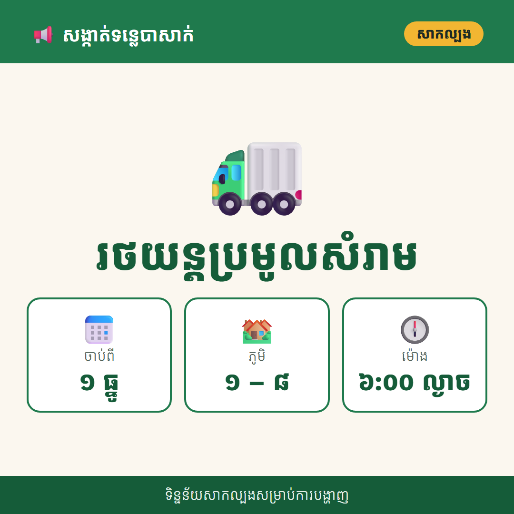
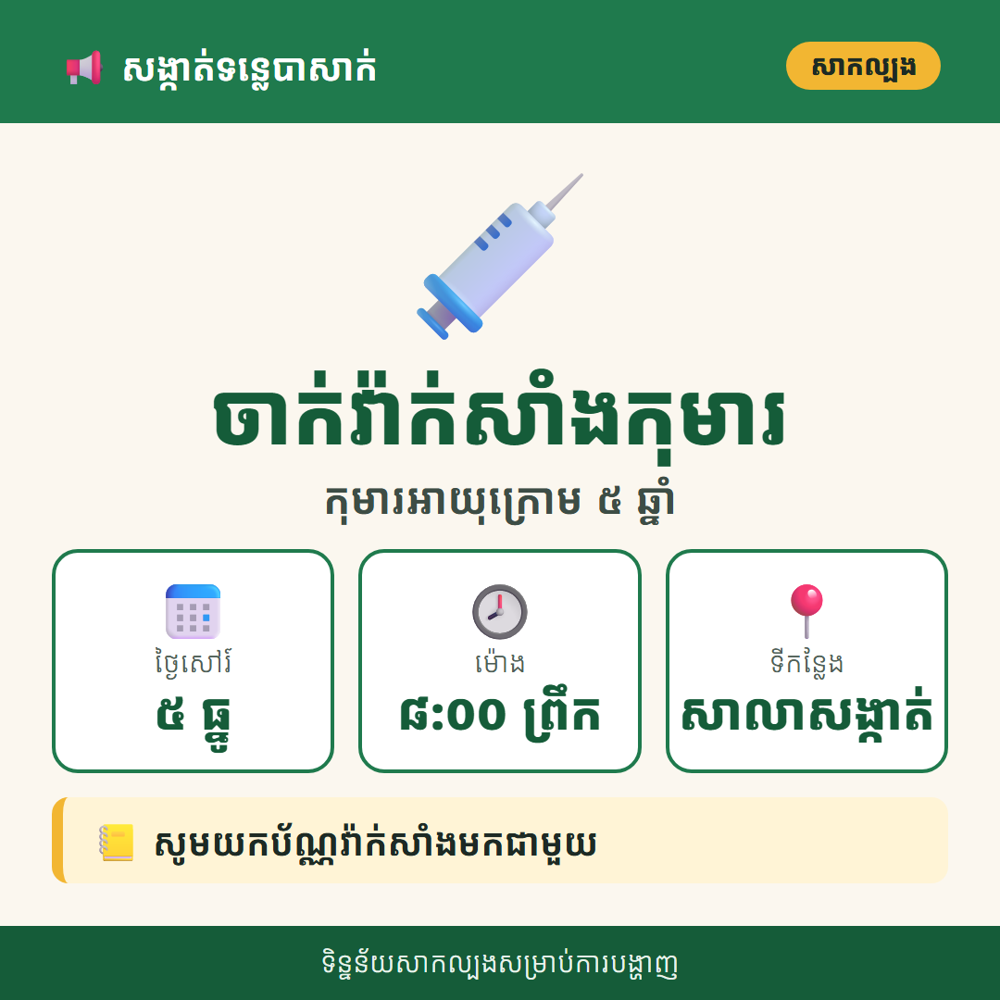
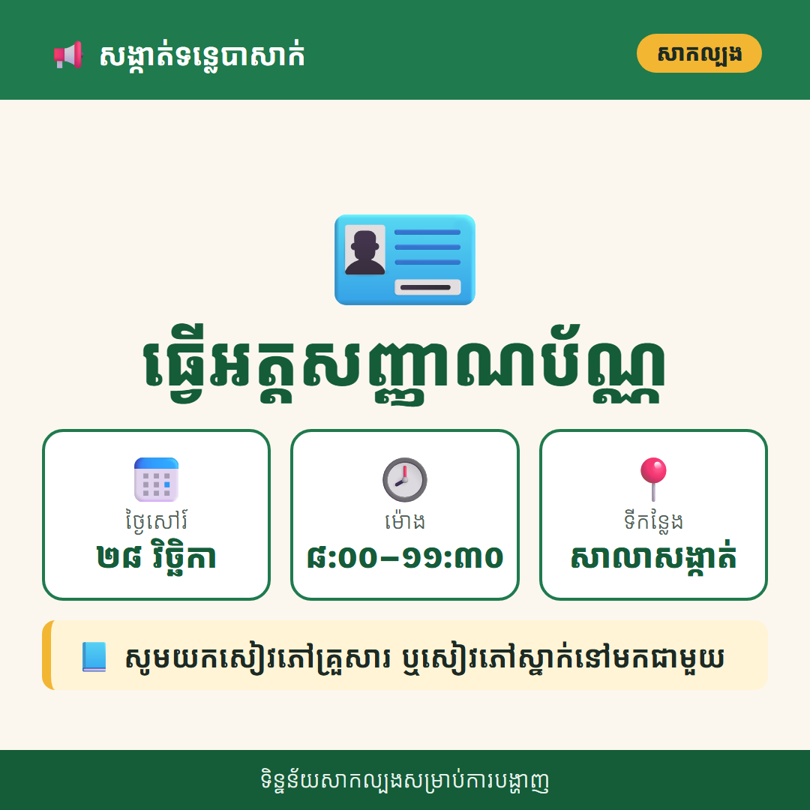

# Announcements in the bot (Khmer + English)

Every announcement the bot holds, as of **21 November 2026**, in Khmer with an English translation.
Each one reaches residents in three forms: **text**, a **flyer picture** and a **voice note**.

- **Demo announcements** are built into the bot (`data/seed/demo_announcements.csv`). They are for Sangkat Tonle Basak (120101).
- "[សាកល្បង]" means **[Test]**: these are demo items, not real sangkat news.
- **📢 ដំណឹងថ្មី** shows residents the **3 newest** that haven't expired.

## Summary

| # | Announcement | Date | Text | Flyer | Voice | Shown in 📢 now? |
| :--- | :--- | :--- | :---: | :---: | :---: | :--- |
| 1 | Garbage truck schedule | From 1 Dec | ✅ | ✅ | ✅ | ✅ Yes, until 31 Dec |
| 2 | Child vaccination | Sat 5 Dec | ✅ | ✅ | ✅ | ✅ Yes, until 5 Dec |
| 3 | ID card registration | Sat 28 Nov | ✅ | ✅ | ✅ | ✅ Yes, until 28 Nov noon |
| 4 | Water Festival traffic | 1–6 Nov | ✅ | — | — | ❌ No, expired 6 Nov |

---

## 1. Garbage truck schedule · រថយន្តប្រមូលសំរាម

**Text**

| Khmer | English |
| :--- | :--- |
| [សាកល្បង] ចាប់ពីថ្ងៃទី១ ខែធ្នូ រថយន្តប្រមូលសំរាមនឹងមកដល់ភូមិ ១ ដល់ ៨ នៅម៉ោង ៦:០០ ល្ងាច។ | [Test] From 1 December, the garbage truck will come to villages 1 to 8 at 6:00 pm. |

**Voice note script**

| Khmer | English |
| :--- | :--- |
| ដំណឹងពីសង្កាត់ទន្លេបាសាក់។ ចាប់ពីថ្ងៃទីមួយ ខែធ្នូ រថយន្តប្រមូលសំរាម នឹងមកដល់ភូមិមួយ ដល់ភូមិប្រាំបី នៅម៉ោងប្រាំមួយល្ងាច។ ខ្ញុំសូមរំលឹកម្តងទៀត៖ ម៉ោងប្រាំមួយល្ងាច ភូមិមួយ ដល់ភូមិប្រាំបី។ | News from Sangkat Tonle Basak. From the first of December, the garbage truck will come to villages one to eight at six in the evening. Once more: six in the evening, villages one to eight. |

**Flyer**

| Khmer | English |
| :--- | :--- |
| រថយន្តប្រមូលសំរាម | Garbage collection truck |
| 📅 ចាប់ពី: ១ ធ្នូ | 📅 Starting: 1 Dec |
| 🏘️ ភូមិ: ១ – ៨ | 🏘️ Villages: 1 – 8 |
| 🕕 ម៉ោង: ៦:០០ ល្ងាច | 🕕 Time: 6:00 pm |

Shown until **31 December**.
Files: `data/demo_media/garbage_truck/`, which holds `flyer.png`, `voice.ogg` and `speech_kh.txt`.

---

## 2. Child vaccination · ការចាក់វ៉ាក់សាំងកុមារ

**Text**

| Khmer | English |
| :--- | :--- |
| [សាកល្បង] ការចាក់វ៉ាក់សាំងកុមារអាយុក្រោម ៥ ឆ្នាំ ថ្ងៃសៅរ៍ ទី៥ ខែធ្នូ ម៉ោង ៨:០០ ព្រឹក នៅសាលាសង្កាត់។ សូមយកប័ណ្ណវ៉ាក់សាំងមកជាមួយ។ | [Test] Vaccination for children under 5, Saturday 5 December, 8:00 am, at the sangkat hall. Please bring the vaccination card. |

**Voice note script**

| Khmer | English |
| :--- | :--- |
| ដំណឹងពីសង្កាត់ទន្លេបាសាក់។ ការចាក់វ៉ាក់សាំងកុមារអាយុក្រោមប្រាំឆ្នាំ ថ្ងៃសៅរ៍ ទីប្រាំ ខែធ្នូ ម៉ោងប្រាំបីព្រឹក នៅសាលាសង្កាត់។ សូមយកប័ណ្ណវ៉ាក់សាំងមកជាមួយ។ | News from Sangkat Tonle Basak. Vaccination for children under five, Saturday the fifth of December, at eight in the morning, at the sangkat hall. Please bring the vaccination card. |

**Flyer**

| Khmer | English |
| :--- | :--- |
| ចាក់វ៉ាក់សាំងកុមារ | Child vaccination |
| កុមារអាយុក្រោម ៥ ឆ្នាំ | Children under 5 |
| 📅 ថ្ងៃសៅរ៍: ៥ ធ្នូ | 📅 Saturday: 5 Dec |
| 🕗 ម៉ោង: ៨:០០ ព្រឹក | 🕗 Time: 8:00 am |
| 📍 ទីកន្លែង: សាលាសង្កាត់ | 📍 Place: Sangkat hall |
| 📒 សូមយកប័ណ្ណវ៉ាក់សាំងមកជាមួយ | 📒 Please bring the vaccination card |

Shown until **5 December, 5 pm**.
Files: `data/demo_media/vaccination/`.

> ⚠️ **No end time.** This item gives only a start time (8:00 am). The other items use a start–end range,
> for example "8:00 – 11:30".

---

## 3. ID card registration · ការចុះធ្វើអត្តសញ្ញាណប័ណ្ណ

**Text**

| Khmer | English |
| :--- | :--- |
| [សាកល្បង] ការចុះធ្វើអត្តសញ្ញាណប័ណ្ណ នៅសាលាសង្កាត់ ថ្ងៃសៅរ៍ ទី២៨ ខែវិច្ឆិកា ម៉ោង ៨:០០ ដល់ ១១:៣០ ព្រឹក។ សូមយកសៀវភៅគ្រួសារ ឬសៀវភៅស្នាក់នៅមកជាមួយ។ | [Test] National ID card registration at the sangkat hall, Saturday 28 November, 8:00 to 11:30 am. Please bring your family book or residence book. |

**Voice note script**

| Khmer | English |
| :--- | :--- |
| ដំណឹងពីសង្កាត់ទន្លេបាសាក់។ ការចុះធ្វើអត្តសញ្ញាណប័ណ្ណ នៅសាលាសង្កាត់ ថ្ងៃសៅរ៍ ទីម្ភៃប្រាំបី ខែវិច្ឆិកា ចាប់ពីម៉ោងប្រាំបីព្រឹក ដល់ម៉ោងដប់មួយកន្លះព្រឹក។ សូមយកសៀវភៅគ្រួសារ ឬសៀវភៅស្នាក់នៅមកជាមួយ។ | News from Sangkat Tonle Basak. National ID card registration at the sangkat hall, Saturday the twenty-eighth of November, from eight to half past eleven in the morning. Please bring your family book or residence book. |

**Flyer**

| Khmer | English |
| :--- | :--- |
| ធ្វើអត្តសញ្ញាណប័ណ្ណ | Get your ID card |
| 📅 ថ្ងៃសៅរ៍: ២៨ វិច្ឆិកា | 📅 Saturday: 28 Nov |
| 🕗 ម៉ោង: ៨:០០–១១:៣០ | 🕗 Time: 8:00–11:30 |
| 📍 ទីកន្លែង: សាលាសង្កាត់ | 📍 Place: Sangkat hall |
| 📘 សូមយកសៀវភៅគ្រួសារ ឬសៀវភៅស្នាក់នៅមកជាមួយ | 📘 Please bring your family book or residence book |

Shown until **28 November, 12 noon**.
Files: `data/demo_media/id_card/`.

> ⚠️ **Expires before the vaccination date.** After 28 November it disappears from 📢. If you film the demo
> after that, extend `expires_at` in `data/seed/demo_announcements.csv` and re-run the seed.

---

## 4. Water Festival traffic · ពិធីបុណ្យអុំទូក (expired)

| Khmer | English |
| :--- | :--- |
| [សាកល្បង] ពិធីបុណ្យអុំទូក៖ សូមប្រជាពលរដ្ឋប្រុងប្រយ័ត្នចរាចរណ៍ នៅតាមដងទន្លេ។ | [Test] Water Festival (Bon Om Touk): residents, please take care with traffic along the riverside. |

Text only, with no flyer or voice. It **expired on 6 November**, so residents no longer see it.
It is kept to show that old news drops off by itself.

---

## Test posts removed today

These were posted from the clerk account while testing on 21 November, then removed with `/delete_last`.
Residents can't see them.

| Khmer | English |
| :--- | :--- |
| [សាកល្បង] ចាប់ពីថ្ងៃទី១ ខែធ្នូ រថយន្តប្រមូលសំរាមនឹងមកដល់ភូមិ ១ ដល់ ៨ នៅម៉ោង ៦:០០ ល្ងាច។ | [Test] From 1 December, the garbage truck will come to villages 1 to 8 at 6:00 pm. *(the same as #1, posted to the group)* |
| 💉 ចាក់វ៉ាក់សាំងជូនកុមារ សូមមាតាបិតា និងអាណាព្យាបាល នាំកូនមកចាក់វ៉ាក់សាំង។ 📅 ថ្ងៃសៅរ៍ ទី៥ ខែធ្នូ 🕗 ម៉ោង ៨:០០ ព្រឹក 📍 នៅសាលាសង្កាត់ 📘 សូមយកសៀវភៅសុខភាពមកជាមួយ។ សូមអរគុណ។ | 💉 Vaccination for children Parents and guardians, please bring your children to be vaccinated. 📅 Saturday 5 December 🕗 8:00 am 📍 At the sangkat hall 📘 Please bring the health book. Thank you. *(made by the AI helper)* |

---

New announcements are posted by clerks through the bot: see [`clerk-guide.md`](clerk-guide.md).
