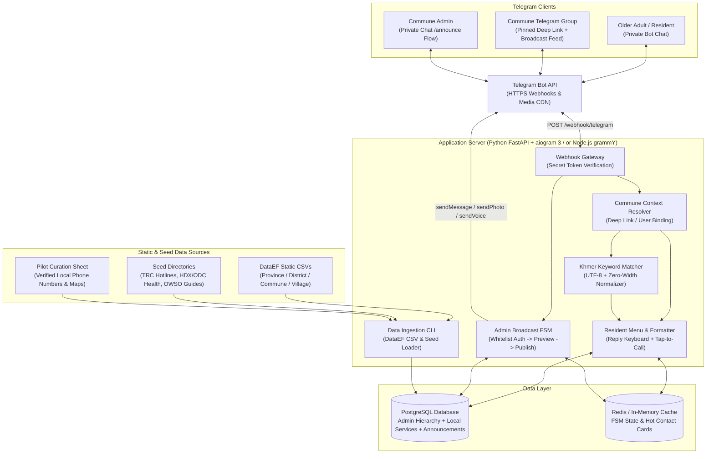
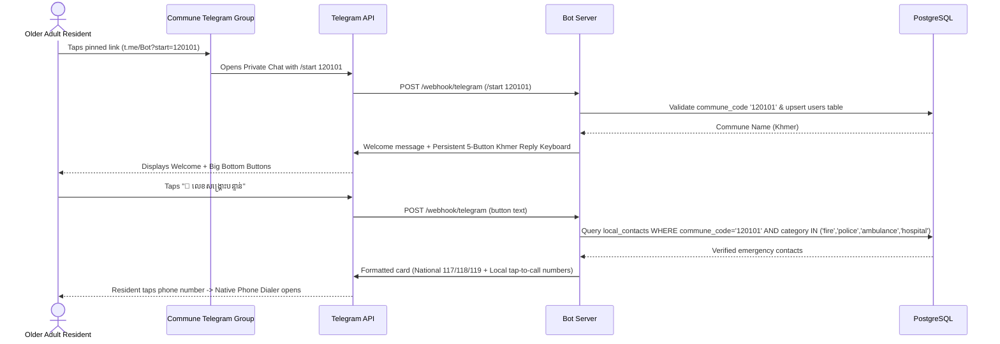
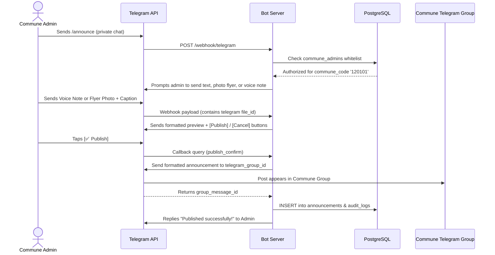

# End-to-End System Architecture
## Centralized Commune Public Service & Announcement Telegram Chatbot

| Field | Details |
| :--- | :--- |
| **Architecture Style** | Modular Monolith (Event-Driven via Telegram Webhooks) |
| **Primary Database** | PostgreSQL 16 (Relational, keyed by DataEF `commune_code`) |
| **Media Strategy** | Zero-Cost Native Telegram `file_id` Storage (MVP) |
| **Target Scale** | Pilot: 1–3 Communes -> Nationwide Ready: 1,652 Communes |

---

## 1. Architecture Philosophy

This architecture is designed around three operational realities of a civic-tech MVP in Cambodia:
1. **Low Operational Cost & High Reliability:** A single stateless application container backed by PostgreSQL can comfortably handle thousands of daily citizen lookups and hundreds of commune groups for under $15/month, with no external LLM or cloud storage costs required in MVP.
2. **DataEF-First Relational Design:** Every commune group, emergency contact, and announcement references the official MLMUPC/DataEF `commune_code` as a foreign key. Scaling from 1 pilot Sangkat to all 25 provinces requires adding data rows—not changing code.
3. **Zero Third-Party Runtime Dependencies for Emergencies:** When a citizen taps `🚨 លេខសង្គ្រោះបន្ទាន់`, the bot reads directly from PostgreSQL (or an in-memory cache) so emergency numbers remain fast and resilient even if external portals are slow or offline.

---

## 2. High-Level System Architecture



---

## 3. Recommended Technology Stack

### Option A: Python Stack (Recommended for DataEF & Future GeoJSON GIS)
* **Bot Framework:** `aiogram 3.x` (native async, clean Finite State Machine for admin flows, webhook support)
* **Web Server:** `FastAPI` + `Uvicorn` (handles `/webhook/telegram` and `/health` endpoints)
* **Database & ORM:** `PostgreSQL 16` + `SQLAlchemy 2.0 (async)` + `Alembic` migrations
* **State & Caching:** `Redis` (or PostgreSQL-backed FSM storage if keeping MVP to a single service)
* **Data & Future GIS:** `pandas` / Python `csv` for DataEF ETL; `shapely` ready for Phase 2 GeoJSON commune boundary lookups

### Option B: TypeScript / Node.js Alternative
* **Bot Framework:** `grammY` (strong TypeScript types, built-in conversations/sessions plugin)
* **Web Server:** `Fastify`
* **Database & ORM:** `PostgreSQL 16` + `Prisma` or `Drizzle ORM`

### Hosting & Infrastructure (MVP)
* **Compute:** Single Docker container on Railway, Fly.io, Render, or a Singapore-region VPS (DigitalOcean / AWS Lightsail — low latency to Phnom Penh) with automatic HTTPS TLS.
* **Backups:** Automated daily `pg_dump` snapshots retained for 14 days.

---

## 4. Core Component Specifications

### 4.1 Webhook Gateway & Security Middleware
* Exposes `POST /webhook/telegram` over HTTPS only.
* Validates Telegram's `X-Telegram-Bot-Api-Secret-Token` header on every incoming request; rejects unauthorized requests with `403 Forbidden`.
* Filters update types cleanly:
  * **Group messages:** Ignored by default (to avoid spamming group chats), except bot membership events (`my_chat_member`) used to log or verify group binding.
  * **Private chat messages & callbacks:** Routed to Admin FSM (if user is in an active admin command) or Resident Handler.

### 4.2 Commune Context Resolver (Zero-Setup Binding)
Resolves which `commune_code` applies to an incoming private message in priority order:
1. **Deep Link Payload:** `/start 120101` -> validates `120101` exists in `commune_configs` with `is_active = TRUE` -> upserts `users.commune_code = '120101'`.
2. **Existing User Session:** Looks up `users.commune_code` by `telegram_user_id`.
3. **Fallback Picker:** If neither exists, displays active pilot communes as large Reply Keyboard buttons so the resident picks their Sangkat in one tap.

### 4.3 Resident Menu Engine & Formatter
* Always attaches the persistent 5-button Khmer Reply Keyboard (`is_persistent=True`, `resize_keyboard=True`).
* Enforces **tap-to-call formatting**: strips parentheses/hyphens inside phone strings where needed and separates multiple numbers on distinct lines so Telegram mobile clients reliably linkify every number.
* Caps announcement feed queries at `LIMIT 5` ordered by `created_at DESC` to keep mobile screens uncluttered for older adults.

### 4.4 Lightweight Khmer Keyword Matcher
Handles residents who type directly instead of tapping buttons:
1. Strips invisible Khmer Zero-Width Space (`\u200b`) and extra whitespace.
2. Matches substring tokens against an indexed keyword dictionary (in memory, refreshed on startup):
   * Emergency triggers: `ភ្លើង`, `អគ្គិភ័យ`, `ប៉ូលីស`, `សង្គ្រោះ`, `គ្រោះថ្នាក់`, `117`, `118`, `119`
   * Health triggers: `ពេទ្យ`, `មន្ទីរពេទ្យ`, `មណ្ឌលសុខភាព`, `ឈឺ`, `សុខភាព`
   * Public service triggers: `សំបុត្រកំណើត`, `កំណើត`, `ស្នាក់នៅ`, `គ្រួសារ`, `អត្តសញ្ញាណ`, `អាពាហ៍ពិពាហ៍`, `សេវា`
   * Location triggers: `ទីតាំង`, `ផែនទី`, `សាលាសង្កាត់`, `សាលាឃុំ`, `ម៉ោង`
3. Routes matched intent directly to the corresponding menu handler. Unmatched inputs trigger a friendly 1-line Khmer fallback guiding them back to the bottom buttons.

### 4.5 Admin Broadcast Engine (Finite State Machine)
Protects commune groups from accidental or unauthorized broadcasts:
* **Step 1 (Auth Check):** On `/announce`, queries `commune_admins` for `(telegram_user_id, is_active = TRUE)`. Unauthorized users receive no admin prompt.
* **Step 2 (Input Capture — `AWAITING_CONTENT`):** Accepts plain text, a single photo + caption, or a voice note + optional short text title. Extracts Telegram's native `file_id` (no S3 bucket needed).
* **Step 3 (Preview — `AWAITING_CONFIRMATION`):** Echoes the exact formatted message back to the admin with inline buttons `[✅ បញ្ជូនទៅក្រុម / Publish]` and `[❌ បោះបង់ / Cancel]`.
* **Step 4 (Atomic Publish & Archive):**
  1. Sends formatted message/media to `commune_configs.telegram_group_id`.
  2. Stores the published post, `telegram_file_id`, and returned `group_message_id` in `announcements`.
  3. Writes an audit entry to `audit_logs`.
  4. Confirms success to the admin (with an option to delete the announcement later via `/delete_last`).

---

## 5. Database Schema Design

### 5.1 Entity Relationship Diagram

```mermaid
erDiagram
    PROVINCES ||--o{ DISTRICTS : contains
    DISTRICTS ||--o{ COMMUNES : contains
    COMMUNES ||--o{ VILLAGES : contains
    COMMUNES ||--o| COMMUNE_CONFIGS : configures
    COMMUNES ||--o{ USERS : binds
    COMMUNES ||--o{ COMMUNE_ADMINS : authorizes
    COMMUNES ||--o{ LOCAL_CONTACTS : has
    COMMUNES ||--o{ ANNOUNCEMENTS : publishes
    COMMUNES ||--o{ PUBLIC_SERVICES : overrides

    COMMUNES {
        varchar commune_code PK
        varchar district_code FK
        varchar province_code FK
        varchar commune_kh
        varchar commune_en
    }

    COMMUNE_CONFIGS {
        varchar commune_code PK_FK
        bigint telegram_group_id UK
        varchar hall_phone
        text office_hours_kh
        text address_kh
        text google_maps_url
        boolean is_active
    }

    USERS {
        bigint telegram_user_id PK
        varchar commune_code FK
        timestamp first_seen_at
        timestamp last_active_at
    }

    COMMUNE_ADMINS {
        serial id PK
        bigint telegram_user_id
        varchar commune_code FK
        varchar full_name
        varchar role
        boolean is_active
    }

    LOCAL_CONTACTS {
        serial id PK
        varchar commune_code FK
        varchar category
        varchar name_kh
        text phone_numbers
        text address_kh
        varchar operating_hours_kh
        boolean is_24h
        text google_maps_url
        int sort_order
    }

    PUBLIC_SERVICES {
        serial id PK
        varchar commune_code FK
        varchar service_key
        varchar title_kh
        text required_docs_kh
        varchar official_fee_khr
        varchar processing_days_kh
        varchar office_level
        text keywords_kh
    }

    ANNOUNCEMENTS {
        serial id PK
        varchar commune_code FK
        bigint posted_by_user_id
        varchar content_type
        text text_kh
        varchar telegram_file_id
        bigint group_message_id
        boolean is_deleted
        timestamp created_at
    }
```

### 5.2 PostgreSQL DDL (Core Tables)

```sql
-- ==========================================
-- TIER 1: DataEF Official Admin Hierarchy
-- ==========================================
CREATE TABLE provinces (
    province_code VARCHAR(10) PRIMARY KEY,
    province_kh   VARCHAR(150) NOT NULL,
    province_en   VARCHAR(150) NOT NULL
);

CREATE TABLE districts (
    district_code VARCHAR(10) PRIMARY KEY,
    province_code VARCHAR(10) NOT NULL REFERENCES provinces(province_code),
    district_kh   VARCHAR(150) NOT NULL,
    district_en   VARCHAR(150) NOT NULL
);

CREATE TABLE communes (
    commune_code  VARCHAR(10) PRIMARY KEY,
    district_code VARCHAR(10) NOT NULL REFERENCES districts(district_code),
    province_code VARCHAR(10) NOT NULL REFERENCES provinces(province_code),
    commune_kh    VARCHAR(150) NOT NULL,
    commune_en    VARCHAR(150) NOT NULL
);

CREATE TABLE villages (
    village_code  VARCHAR(12) PRIMARY KEY,
    commune_code  VARCHAR(10) NOT NULL REFERENCES communes(commune_code),
    village_kh    VARCHAR(150) NOT NULL,
    village_en    VARCHAR(150) NOT NULL
);

-- ==========================================
-- TIER 2: Commune Configuration & Users
-- ==========================================
CREATE TABLE commune_configs (
    commune_code      VARCHAR(10) PRIMARY KEY REFERENCES communes(commune_code),
    telegram_group_id BIGINT UNIQUE,
    hall_name_kh      VARCHAR(200) NOT NULL,
    hall_phone        VARCHAR(100),
    office_hours_kh   TEXT NOT NULL,
    address_kh        TEXT NOT NULL,
    google_maps_url   TEXT,
    is_active         BOOLEAN NOT NULL DEFAULT FALSE,
    updated_at        TIMESTAMPTZ NOT NULL DEFAULT NOW()
);

CREATE TABLE users (
    telegram_user_id BIGINT PRIMARY KEY,
    commune_code     VARCHAR(10) REFERENCES communes(commune_code),
    first_seen_at    TIMESTAMPTZ NOT NULL DEFAULT NOW(),
    last_active_at   TIMESTAMPTZ NOT NULL DEFAULT NOW()
);

CREATE TABLE commune_admins (
    id               SERIAL PRIMARY KEY,
    telegram_user_id BIGINT NOT NULL,
    commune_code     VARCHAR(10) NOT NULL REFERENCES communes(commune_code),
    full_name        VARCHAR(150) NOT NULL,
    role             VARCHAR(20) NOT NULL DEFAULT 'admin' CHECK (role IN ('admin', 'superadmin')),
    is_active        BOOLEAN NOT NULL DEFAULT TRUE,
    created_at       TIMESTAMPTZ NOT NULL DEFAULT NOW(),
    UNIQUE (telegram_user_id, commune_code)
);

-- ==========================================
-- TIER 3: Public Services, Contacts & News
-- ==========================================
CREATE TABLE local_contacts (
    id                 SERIAL PRIMARY KEY,
    commune_code       VARCHAR(10) NOT NULL REFERENCES communes(commune_code),
    category           VARCHAR(30) NOT NULL CHECK (
                           category IN ('fire', 'police', 'ambulance', 'hospital', 'health_center', 'village_chief')
                       ),
    name_kh            VARCHAR(200) NOT NULL,
    phone_numbers      TEXT NOT NULL,
    address_kh         TEXT,
    operating_hours_kh VARCHAR(150),
    is_24h             BOOLEAN NOT NULL DEFAULT FALSE,
    google_maps_url    TEXT,
    sort_order         INT NOT NULL DEFAULT 10,
    is_verified        BOOLEAN NOT NULL DEFAULT TRUE,
    updated_at         TIMESTAMPTZ NOT NULL DEFAULT NOW()
);

CREATE INDEX idx_local_contacts_commune_cat ON local_contacts (commune_code, category, sort_order);

CREATE TABLE public_services (
    id                 SERIAL PRIMARY KEY,
    commune_code       VARCHAR(10) REFERENCES communes(commune_code), -- NULL = nationwide OWSO default
    service_key        VARCHAR(50) NOT NULL,
    title_kh           VARCHAR(200) NOT NULL,
    required_docs_kh   TEXT NOT NULL,
    official_fee_khr   VARCHAR(100) NOT NULL,
    processing_days_kh VARCHAR(100) NOT NULL,
    office_level       VARCHAR(30) NOT NULL CHECK (office_level IN ('commune', 'district_owso')),
    keywords_kh        TEXT,
    sort_order         INT NOT NULL DEFAULT 10
);

CREATE TABLE announcements (
    id                SERIAL PRIMARY KEY,
    commune_code      VARCHAR(10) NOT NULL REFERENCES communes(commune_code),
    posted_by_user_id BIGINT NOT NULL,
    content_type      VARCHAR(20) NOT NULL CHECK (content_type IN ('text', 'photo', 'voice')),
    text_kh           TEXT,
    telegram_file_id  VARCHAR(255),
    group_message_id  BIGINT,
    is_deleted        BOOLEAN NOT NULL DEFAULT FALSE,
    created_at        TIMESTAMPTZ NOT NULL DEFAULT NOW()
);

CREATE INDEX idx_announcements_feed ON announcements (commune_code, is_deleted, created_at DESC);

CREATE TABLE audit_logs (
    id               SERIAL PRIMARY KEY,
    actor_user_id    BIGINT NOT NULL,
    commune_code     VARCHAR(10),
    action           VARCHAR(50) NOT NULL,
    target_id        VARCHAR(50),
    metadata_json    JSONB,
    created_at       TIMESTAMPTZ NOT NULL DEFAULT NOW()
);
```

---

## 6. End-to-End Sequence Flows

### 6.1 Resident Emergency Lookup via Pinned Group Link



### 6.2 Commune Admin Announcement Broadcast



---

## 7. Data Ingestion & Maintenance Pipeline

### 7.1 DataEF Annual Sync (Idempotent Upsert)
A standalone CLI script (`scripts/ingest_dataef.py`) ingests the 4 static CSVs downloaded from `data.mef.gov.kh`:
1. Validates UTF-8 encoding and required columns (`province_code`, `district_code`, `commune_code`, `village_code`, `_kh`, `_en`).
2. Loads in strict foreign-key order: `provinces` -> `districts` -> `communes` -> `villages`.
3. Uses PostgreSQL `INSERT ... ON CONFLICT (commune_code) DO UPDATE` so existing `commune_configs`, `local_contacts`, and `announcements` remain intact when DataEF releases 2026+ updates.

### 7.2 Local Commune Data Onboarding Workflow
To onboard a new commune without manual SQL edits:
1. Maintain a clean structured CSV/Google Sheet template (`commune_seed_template.csv`) containing `commune_code`, `category`, `name_kh`, `phone_numbers`, `operating_hours_kh`, `google_maps_url`.
2. Run `scripts/validate_and_load_commune.py`:
   * Verifies `commune_code` exists in DataEF `communes`.
   * Validates Cambodian phone number formats (short codes `115–1299` and mobile/landline `0XX XXX XXX(X)`).
   * Validates Google Maps URLs begin with `https://`.
   * Upserts verified rows and activates the commune (`is_active = TRUE`).

---

## 8. Security, Rate Limiting & Reliability

* **Webhook Authentication:** Enforce `secret_token` when calling Telegram's `setWebhook` API and reject any request missing a matching `X-Telegram-Bot-Api-Secret-Token` header.
* **Group Permission Safeguards:** Before publishing an announcement, handle Telegram API errors gracefully (e.g., `Forbidden: bot was kicked from the group` or `ChatWriteForbidden`) by notifying both the Commune Admin and Platform Super Admin with clear remediation steps.
* **Telegram Rate Limits:** Telegram allows up to 20 messages/minute to the same group and 30 messages/second globally. Because broadcasts go to 1 commune group (rather than DMing every citizen individually), group broadcasts stay well within limits and scale cleanly.
* **Media Reliability:** Telegram `file_id` strings are bound to the specific bot token and persist indefinitely on Telegram servers. If you ever migrate to a new bot token in the future, add an optional S3/Cloudflare R2 mirror during Phase 2.
* **Observability:** Emit structured JSON logs (`event_type`, `commune_code`, `latency_ms`, `status`)—never log user free-text PII—and set up a `/health` endpoint monitored by UptimeRobot or Better Stack.

---

## 9. Evolution Path (MVP to V2)

This architecture avoids premature complexity while keeping clean extension points for V2:
1. **GPS Auto-Detection (DataEF GeoJSON):** Add PostGIS (`ST_Contains`) or load `Cambodia Commune Boundaries` GeoJSON into memory via `shapely` so residents outside a group can tap Telegram's native `📍 Share My Location` button to auto-bind their commune.
2. **Voice-to-Action for Illiterate Users:** Connect resident private voice notes to a Khmer Speech-to-Text endpoint, then feed the transcript straight into the existing Khmer Keyword Matcher (`4.4`).
3. **Web Admin Dashboard:** Because all state lives in PostgreSQL behind clean relational tables, a future Next.js/React web portal for Ministry of Interior or Sangkat clerks can read and write directly to the exact same `local_contacts` and `announcements` tables without touching bot code.